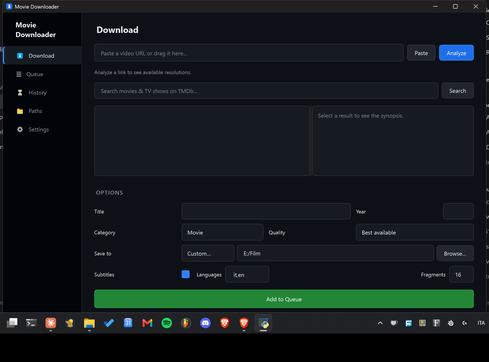

# Movie Downloader

A sleek, dark-themed desktop app for downloading movies and TV shows with queue management, TMDb integration, and automatic subtitles.

Built with **Python 3.11+**, **PySide6**, and **yt-dlp**.


---

## Features

- **Smoked-glass UI** — dark panels, responsive layout and readable poster cards
- **Movie backgrounds** — blurred, darkened TMDb artwork follows the selected title, with poster fallback
- **Queue system** — add multiple downloads, process them one by one. Queue persists between sessions
- **TMDb search** — search movies and TV shows together, with posters, synopses, and auto-fill of title/year
- **Automatic subtitles** — downloads and embeds subtitles (default: Italian + English)
- **Quality selection** — best, 1080p, 720p, 480p, or audio-only M4A
- **Parallel fragments** — up to 16 concurrent HLS/DASH fragments
- **Custom save paths** — create named shortcuts for quick destination switching
- **Download history** — full log of past downloads
- **System tray** — minimizes to tray with toast notifications
- **Drag & drop** — drop a URL to start
- **Auto-update** — checks for new releases on startup, one-click yt-dlp update in Settings
- **Multi-language** — English (default) and Italian, switchable in Settings
- **Pause / Resume / Cancel** — full queue control
- **Smart naming** — Unicode, reserved names, collision numbering
- **Portable** — builds to standalone .exe with PyInstaller

## Screenshot



## Quick Start

### From source

```bash
git clone https://github.com/FreshGhetto/movie-downloader.git
cd movie-downloader

py -3.11 -m venv .venv
.venv\Scripts\python.exe -m pip install -r requirements.txt
.venv\Scripts\python.exe main.py
```

### Build standalone .exe

```bash
.venv\Scripts\python.exe scripts\build_release.py
```

Or run `CreaExe.bat`. The build reads `config/version.py` and embeds the version in the Windows executable properties.

Output for the current release: `dist-aggiornata/v2.2.0/MovieDownloader-v2.2.0.exe`.
This is a standalone Windows x64 executable; Python is not required on the destination computer.
The same directory contains a ZIP distribution, release notes and SHA-256 checksums.
`Avvia aggiornato.bat` is updated by the build to launch this version.

See the [2.2.0 release notes](releases/v2.2.0.md) and [changelog](CHANGELOG.md).

### Requirements

- **Python 3.11+**
- **FFmpeg** on PATH or configured in Settings
- **yt-dlp** bundled in `bin/`
- **TMDb API key** (optional) — free at [themoviedb.org](https://developer.themoviedb.org/)

## Usage

1. **Paste or drag** a video URL
2. **Analyze** — extracts metadata and resolutions
3. **Search TMDb** (optional) — fills title, year, poster
4. Pick **quality**, **destination**, **subtitles**
5. **Add to queue** → **Start**

### Custom Paths

Create named shortcuts in the **Paths** tab:

| Name | Path |
|------|------|
| Anime | `D:\Anime` |
| Documentari | `E:\Documentari` |
| Corsi | `C:\Users\Me\Courses` |

They appear as a dropdown next to the destination field.

## Project Structure

```
main.py              # Entry point
gui/window.py        # PySide6 GUI
services/core.py     # URL validation, naming, yt-dlp commands
services/workers.py  # Background threads (analysis, TMDb, updates)
config/settings.py   # Persistence (settings, queue, history)
tests/               # Unit and GUI tests
bin/yt-dlp.exe       # Bundled yt-dlp
```

## Contributing

PRs welcome. One feature per PR, test your changes, follow existing style.

## License

MIT

---

*This product uses the TMDb API but is not endorsed or certified by TMDb.*
